# Active Directory Security Lab

### Enterprise Windows Server Administration, Network Security & Threat Monitoring

A hands-on cybersecurity homelab built using **Windows Server 2025**, **Windows 11**, and **Oracle VirtualBox** to simulate a small enterprise network.

The project demonstrates Active Directory administration, network services, identity and access management, endpoint security hardening, and authentication monitoring.

## 1. Project Objectives

- Deploy a Windows Server domain controller.
- Configure Active Directory Domain Services (AD DS).
- Manage organizational units, users, and security groups.
- Configure DNS and DHCP.
- Join a Windows 11 workstation to the domain.
- Implement Group Policy security controls.
- Restrict access to departmental file shares.
- Enforce account logon-hour restrictions.
- Monitor failed Kerberos authentication using PowerShell.

## 2. Lab Environment

| Component | Configuration |
|---|---|
| Virtualization | Oracle VirtualBox |
| Server | Windows Server 2025 Datacenter Evaluation |
| Client | Windows 11 Pro |
| Domain | `cyberlab.test` |
| Domain Controller | DC01 |
| Domain Controller IP | `10.10.10.10` |
| Workstation | CLIENT01 |
| Workstation IP | `10.10.10.100` |
| Internal Network | `10.10.10.0/24` |
| Additional Connectivity | Separate NAT adapters |

### Network Architecture

DC01 provides centralized domain authentication, DNS, DHCP, Group Policy, and departmental file sharing.

CLIENT01 is a domain-joined workstation that receives its internal IP configuration through DHCP and applies domain security policies.

## 3. Active Directory Configuration

Created an Active Directory forest using the domain `cyberlab.test`.

Organized user accounts into departmental organizational units:

- IT
- HR
- Finance
- Sales

Created separate organizational units for security groups and computers.

Configured test accounts and departmental security groups, including `IT-Staff` and `HR-Staff`.

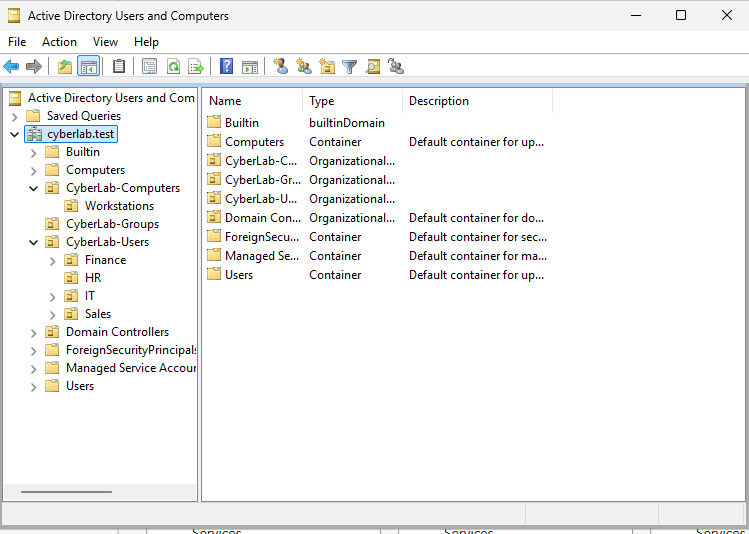

## 4. DNS and DHCP

Configured DNS to support internal domain name resolution and Active Directory services.

Configured a DHCP scope covering `10.10.10.100` through `10.10.10.200`, with an eight-day lease duration.

Reserved `10.10.10.100` for CLIENT01 and verified the active DHCP lease.

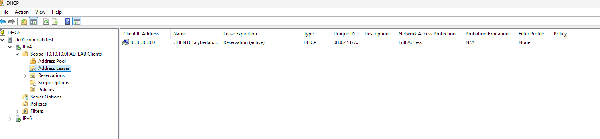

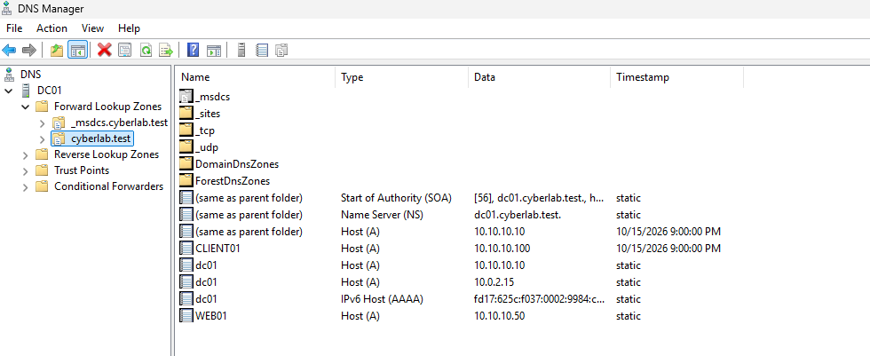

## 5. Group Policy and Endpoint Security

Implemented and tested security settings using Group Policy Objects (GPOs).

Security configurations included:

- Password complexity and a minimum password length of 12 characters.
- Account lockout after five failed attempts.
- Automatic workstation lock after 600 seconds of inactivity.
- Microsoft Defender Firewall enabled.
- Microsoft Defender real-time protection enabled.
- Removable disk write restrictions.
- RDP inbound traffic blocked through a custom firewall rule.
- Successful and failed logon auditing.

Verified applied computer policies on CLIENT01 using:

`gpresult /r /scope computer`

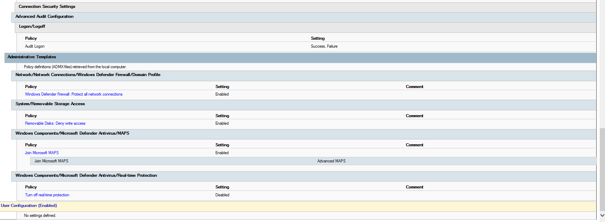

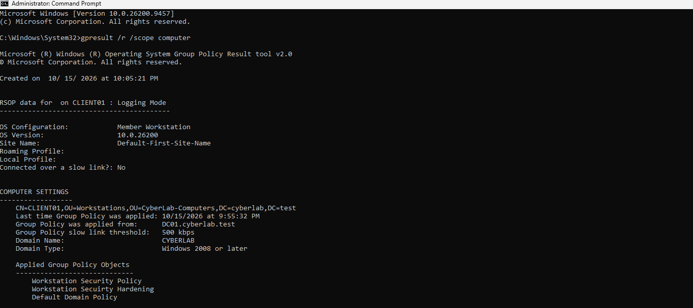

## 6. Role-Based Access Control

Created departmental file shares:

- `\\DC01\IT`
- `\\DC01\HR`

Configured NTFS permissions using departmental Active Directory security groups.

Assigned Modify access to the corresponding departmental groups and configured mapped drives through Group Policy.

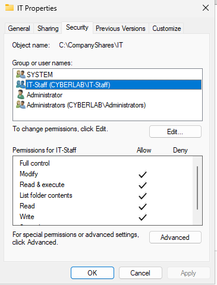

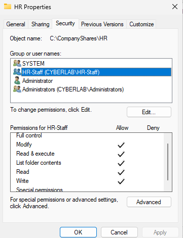

## 7. Logon Hours Enforcement

Configured Active Directory logon-hour restrictions for the test user Michael Brown.

Attempted to sign in to the domain-joined Windows 11 workstation outside the permitted schedule.

Windows denied the sign-in and displayed a message indicating that the account was restricted from logging in at that time.

This test demonstrated time-based access control enforced through Active Directory.

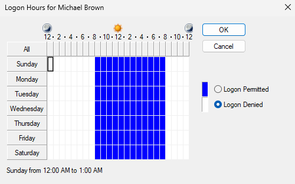

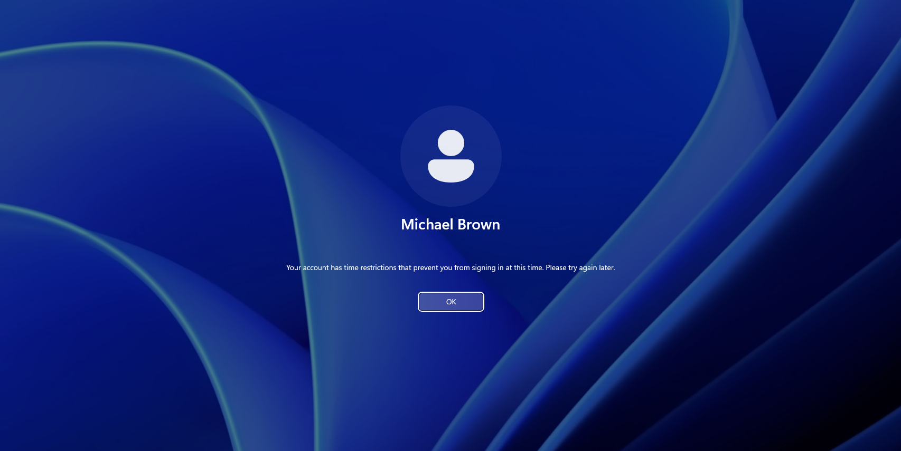

## 8. Kerberos Authentication Monitoring

Enabled Kerberos authentication auditing on the domain controller.

Generated failed authentication attempts from CLIENT01 and inspected Windows Security Event ID **4771**.

Observed failure code `0x18`, indicating incorrect Kerberos pre-authentication information, commonly caused by an incorrect password.

Developed a PowerShell monitoring script that:

- Retrieves Event ID 4771 from the previous 24 hours.
- Extracts usernames, source IP addresses, and failure codes.
- Counts authentication failures.
- Groups failures by source IP address.
- Displays warnings when configured thresholds are reached.
- Supports exporting the collected report to CSV.

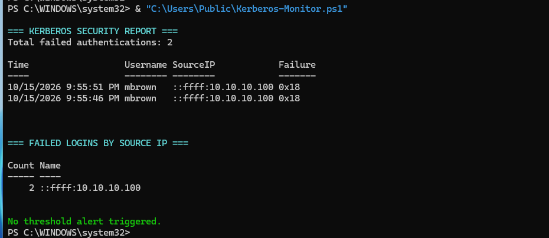

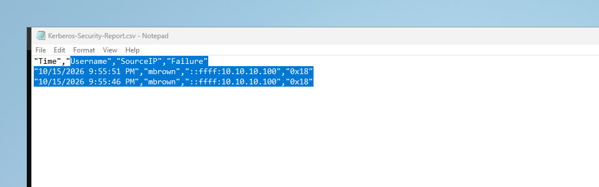

## 9. Testing and Validation

| Security Feature | Validation |
|---|---|
| Domain membership | CLIENT01 joined `cyberlab.test` |
| DHCP | CLIENT01 received its reserved IP address |
| Group Policy | Policies confirmed using `gpresult` |
| Endpoint hardening | Defender, firewall, and USB write restrictions checked |
| Department permissions | NTFS group permissions inspected |
| Logon hours | Sign-in outside permitted hours denied |
| Kerberos monitoring | Event ID 4771 failures detected |
| PowerShell reporting | Authentication failures displayed and exported to CSV |

## 10. Skills Demonstrated

**Windows Server Administration:** Active Directory, DNS, DHCP, Group Policy, and file services.

**Identity and Access Management:** Domain authentication, security groups, NTFS permissions, account policies, and logon-hour restrictions.

**Cybersecurity:** Endpoint hardening, firewall rules, authentication auditing, and security event investigation.

**Automation:** PowerShell scripting, Windows Event Log analysis, and CSV reporting.

## 11. Lessons Learned

This project provided practical experience configuring and securing a Windows enterprise environment.

Key lessons included understanding how domain services work together, applying centralized security policies, managing access through security groups, and investigating authentication failures through Windows Security logs.

The lab also demonstrated how PowerShell can automate repetitive security monitoring tasks.

## 12. Project Scope

This project was completed in an isolated VirtualBox homelab for educational and cybersecurity portfolio purposes.

The environment simulates selected enterprise security practices and is not presented as a production-ready deployment.

---

**Technologies:** Windows Server 2025 | Windows 11 | Active Directory | DNS | DHCP | Group Policy | PowerShell | Windows Event Viewer | Oracle VirtualBox
